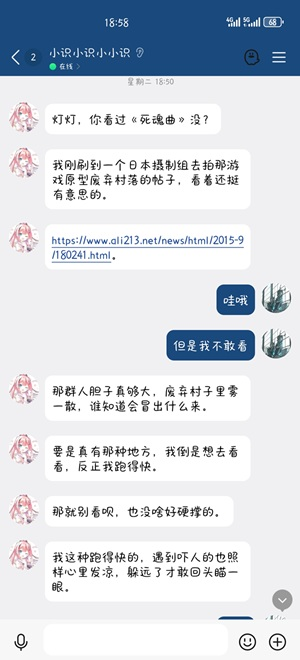
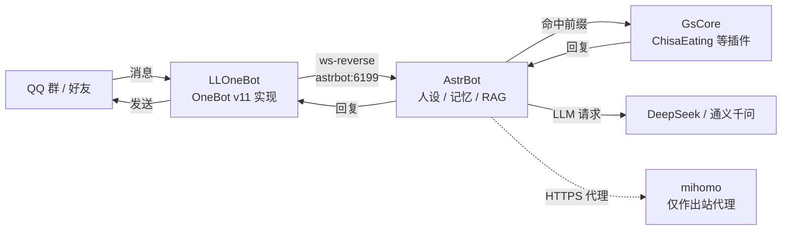

# hoshino-bots-learning

> 在一台 4 GiB 内存的阿里云 ECS 上，用 Docker 把三层 QQ 机器人跑起来：
> **LLOneBot 收消息 → AstrBot 做人设 / 记忆 / RAG → GsCore 跑游戏向插件**。
> 这个仓库是搭建笔记 + 配置模板 + 真实排障复盘，不是一键包。

---

## 这个仓库是什么

- **是**：一台 Linux 服务器上的容器编排、四个服务的配置模板、消息链路说明、以及我踩过的坑。
- **是**：一次从零开始的练习——建 Docker 网络、限制端口、配反向 WebSocket、接插件、调 RAG、看日志排障。
- **不是**：一键安装包，也不是上游项目的 fork。
- **不包含**：任何上游源码、QQ 账号数据、聊天记录、日志、API Key、Token。

> 仓库里的镜像 tag（如 `astrbot:latest`）是我机器上的名字。镜像本身来自上游发布或本地已有，本项目**没有**构建镜像。
> 运行中的上游代码没有改动；早期给雀魂插件打的本地补丁没有提交，后来随插件一起移除了（见[复盘](docs/retrospectives/2026-10-16-majsoul.md)）。

### 和最近那些「DSH 一键机器人」的区别

近期出现了一批基于 DSH（DeepSeek Harness）的插件式方案，比如 [BiliMemory](https://github.com/binbin-QAQ/BiliMemory)：Windows 上一键装好，就能刷 B 站、留评论、接 QQ 群。它解决的是「最快用上」。

这个仓库解决的是「自己搭一遍」：

| 维度 | 本项目 | DSH 插件式一键方案 |
| --- | --- | --- |
| 运行环境 | Linux ECS + Docker | Windows 桌面为主 |
| 链路 | 四个容器（3 个业务 + 1 个代理） | 大多由 DSH 宿主统一调度 |
| 部署 | 手动建网络、写 compose、扫码、逐项调参 | 脚本一键安装 |
| 可替换性 | 每一层都能单独换 | 与 DSH 插件生态绑定 |
| 仓库内容 | 踩坑、复盘、配置模板 | 开箱即用 |
| 适合谁 | 想练 Linux / Docker / 排障 | 想立刻有个能用的 bot |

如果你只想马上有一个能用的机器人，建议直接用上游的 Docker 部署或上面那类一键方案；这里更像是「施工记录」。

---

## 它能做什么

| 能力 | 由谁提供 |
| --- | --- |
| 群聊 / 私聊角色扮演，带人设和长期记忆 | AstrBot + 陪伴核心系列插件 |
| 主动发言、表情包、图片反搜 | AstrBot 插件（proactive_chat / meme_manager / reverse_searcher） |
| 解析 B 站链接、读视频内容、B 站评论互动 | AstrBot 插件（biliread / bilibili_bot / bilibili_ai_bot） |
| 提示词注入防护 | AstrBot 插件 antipromptinjector |
| 跨次元「吃什么 / 喝什么 / 黑暗料理」 | GsCore 插件 ChisaEating |
| 知识库问答（寓言、百科、角色背景、gal 梗） | AstrBot RAG + 阿里云百炼嵌入 / 重排 |
| 按前缀把游戏指令切给 GsCore，不再走 LLM | `astrbot_plugin_gscore_adapter` |

## 效果



群聊里的一次普通对话，只放这一张。

---

## 架构



一条群消息的完整路径：

1. **LLOneBot**（跑着 QQ NT 客户端的容器）收到消息，通过 **反向 WebSocket**（由 LLOneBot 主动连 AstrBot，而不是 AstrBot 去连它）推给 AstrBot 的 `6199` 端口。
2. **AstrBot** 先看消息是否命中游戏前缀（`core`、`gs`、`sr`、`zzz`、`ww`、`蝙蝠` 等）。命中就转给 GsCore，并**切断后续 LLM 流程**；没命中就走人设 + 记忆 + RAG + LLM。
3. **GsCore** 是插件宿主（自己不直连 QQ），AstrBot 通过 `astrbot_plugin_gscore_adapter` 以 `BOT_ID=AstrBot` 连到它的 `8765`。查完把结果回给 AstrBot。
4. 回复沿原路返回 LLOneBot，再由它发到 QQ。

四个容器都在同一条自定义桥接网络 `bot-net` 上，所以它们之间用**容器名**互相访问（`astrbot`、`gsuid_core`、`mihomo`），不依赖宿主机端口。mihomo 只给 AstrBot 做出站代理，用来访问 LLM API。

更细的端口、网络和设计取舍见 [docs/architecture.md](docs/architecture.md)。

---

## 我做了什么

| 事项 | 具体内容 |
| --- | --- |
| 选型与编排 | 把收消息、对话、游戏插件拆成 4 个容器；自建 bridge 网络；WebUI 端口全部收在 `127.0.0.1` |
| 镜像与配置 | 准备 4 个镜像；改 compose 注入时区、重启策略、代理变量 |
| 链路打通 | LLOneBot 反向 WS → AstrBot；AstrBot 插件 → GsCore（`gsuid_core:8765`） |
| 插件磨合 | 11 个 AstrBot 插件 + 1 个 GsCore 插件；配前缀分流、群黑白名单 |
| 成本控制 | 用陪伴核心插件的「DeepSeek 高价时段替换」把高峰流量切到千问 |
| RAG | 整理 5 个知识库，WebUI 里按 1024 / 120 切分，嵌入与重排都用阿里云百炼 |
| 排障复盘 | 雀魂插件因上游改版下线（见 [复盘](docs/retrospectives/2026-10-16-majsoul.md)）、代理、内存、容器 IP 漂移 |
| 没做 | 没有向上游提交代码；没有写一键脚本 |

---

## 组件与版本

| 组件 | 版本 | 镜像 tag（示例） | 端口 | 作用 |
| --- | --- | --- | --- | --- |
| LLOneBot | 7.12.15 | `llonebot:latest` | 3000 / 3001 / 3080 / 5900 / 6099 | QQ 登录与 OneBot v11 协议 |
| AstrBot | 4.28.1 | `astrbot:latest` | 6185 / 6199 | 人设、记忆、RAG、插件宿主 |
| GsCore | 0.11.2 | `gsuid-core:runtime` | 8765 | 游戏向插件宿主 |
| mihomo | 1.19.32 | `mihomo:v1.19.32` | 仅容器内 7890 | 出站代理 |

服务器：阿里云 ECS，4 GiB 规格（系统显示 3.5 GiB）/ 40 GB 系统盘 / 4 GiB swap，Linux。目前正在迁往新服务器，见[业务迁移](#业务迁移--维护计划)。

插件清单：

| 插件 | 宿主 | 作用 |
| --- | --- | --- |
| [astrbot_plugin_gscore_adapter](https://github.com/KimigaiiWuyi/astrbot_plugin_gscore_adapter) | AstrBot | AstrBot ↔ GsCore 的桥 |
| [astrbot_plugin_private_companion](https://github.com/menglimi/astrbot_plugin_private_companion) | AstrBot | 陪伴核心：私聊人设与情绪 |
| memory_companion | AstrBot | 长期记忆（与 private_companion 配套） |
| content_companion | AstrBot | 内容记忆 / 故事线 |
| [astrbot_plugin_proactive_chat](https://github.com/Pancakes-Labs/astrbot_plugin_proactive_chat) | AstrBot | 主动发言 |
| [meme_manager](https://github.com/anka-afk/astrbot_plugin_meme_manager) | AstrBot | 表情包管理 |
| [reverse_searcher](https://github.com/OMSociety/astrbot_plugin_reverse_searcher) | AstrBot | 图片反搜 |
| [astrbot_plugin_biliread](https://github.com/SodaCodeSave/astrbot_plugin_biliread) | AstrBot | 让 AI 读懂 B 站视频 |
| [astrbot_plugin_bilibili_bot](https://github.com/drdon1234/astrbot_plugin_bilibili_bot) | AstrBot | B 站链接转直链 |
| [astrbot_plugin_bilibili_ai_bot](https://github.com/chenluQwQ/astrbot_plugin_bilibili_ai_bot) | AstrBot | B 站评论 / 私信 / 弹幕互动 |
| [antipromptinjector](https://github.com/oyxning/astrbot_plugin_antipromptinjector) | AstrBot | 提示词注入防护 |
| [ChisaEating](https://github.com/MimoKit/ChisaEating) | GsCore | 跨次元干饭 |

> AstrBot 在 GitHub 上热度很高（曾登上 Trending 日榜），「陪伴核心」系列插件是社区里讨论度很高的一套方案。本项目只使用它们，不修改源码。

---

## 目录结构

```text
.
├── README.md
├── LICENSE
├── NOTICE
├── .gitignore
├── deploy/                     # 四份 compose，按服务拆开放
│   ├── mihomo/compose.yaml
│   ├── llonebot/docker-compose.yml
│   ├── astrbot/compose.yml
│   └── gscore/
│       ├── docker-compose.yml
│       └── gsuid_core/         # 运行时 clone 的 GsCore 源码，不进仓库
├── config/                     # 只放脱敏模板，真实配置在服务器上
│   ├── astrbot/README.md       # 需要在 WebUI 里填哪些项
│   ├── gscore/config.example.json
│   ├── llonebot/config.example.json
│   └── mihomo/config.example.yaml
└── docs/
    ├── architecture.md         # 端口 / 网络 / 设计取舍
    ├── troubleshooting.md      # 症状 → 原因 → 处理
    ├── tuning-log.md           # 2026-10 调参记录
    ├── migration.md            # ECS 业务迁移清单
    └── retrospectives/
        └── 2026-10-16-majsoul.md
```

---

## 快速开始

> 假设你已经有一台 Linux 服务器、装好 Docker 与 Compose 插件，并且有一个可以登录的 QQ 小号。
> 下面所有命令都在**服务器**上执行；`<...>` 是需要你替换的占位符。

### 0. 准备四个镜像

本项目不构建镜像。请按各上游文档获取 AstrBot、GsCore、LLOneBot、mihomo 的镜像，并打成 compose 里用的 tag；或者直接把 compose 里的 `image:` 改成你实际使用的镜像名。

### 1. 创建共用网络

```bash
# 创建一条自定义桥接网络；四个容器都接上来，之后可以用容器名互相访问
docker network create bot-net
```

> 这一步只需做一次。网络已存在时会报 `already exists`，可以忽略。

### 2. 准备配置

```bash
# 把 GsCore 源码克隆到它的 compose 旁边；compose 会把这里挂进容器的 /gsuid_core
git clone https://github.com/Genshin-bots/gsuid_core deploy/gscore/gsuid_core

# 安装 GsCore 插件（示例：ChisaEating）；放在插件目录，重启 GsCore 后自动加载
git clone https://github.com/MimoKit/ChisaEating deploy/gscore/gsuid_core/gsuid_core/plugins/ChisaEating

# 复制配置模板（示例路径以 mihomo 为例）
cp config/mihomo/config.example.yaml deploy/mihomo/config.yaml

# 编辑配置，填入你自己的订阅 / Token；这些文件已被 .gitignore 排除
vi deploy/mihomo/config.yaml
```

四个服务分别需要：

| 服务 | 配置文件 | 必填项 |
| --- | --- | --- |
| mihomo | `deploy/mihomo/config.yaml` | 你的代理订阅（不提交） |
| llonebot | `deploy/llonebot/llonebot-data/data/config_<QQ号>.json` | 反向 WS 地址 `ws://astrbot:6199/ws`、Token |
| astrbot | WebUI 里配置 | OneBot 平台、LLM 提供商、嵌入/重排模型 |
| gscore | `deploy/gscore/gsuid_core/data/config.json` | `WS_TOKEN`、主人 / 超级用户 QQ |

> GsCore 的 `data/config.json` 首次启动时会自动生成，先起一次容器，再改 Token 和主人 QQ。

### 3. 按顺序启动

```bash
# 先起代理（AstrBot 之后要用它访问 LLM）
cd deploy/mihomo && docker compose up -d

# 再起 QQ 客户端，首次需要扫码登录
cd ../llonebot && docker compose up -d

# 然后起 AstrBot（依赖 6199 被 LLOneBot 连接）
cd ../astrbot && docker compose up -d

# 最后起 GsCore（AstrBot 的适配器会连它）
cd ../gscore && docker compose up -d
```

### 4. 扫码登录 QQ

LLOneBot 的 WebUI 默认在容器 `3080` 端口，但只绑定了 `127.0.0.1`。在**你自己的电脑**上开一条 SSH 隧道：

```bash
# 把服务器的 3080 映射到本机 3080；浏览器访问 http://127.0.0.1:3080
ssh -L 3080:127.0.0.1:3080 root@<ECS_IP>
```

登录后，在 LLOneBot 里把 OneBot v11 的**反向 WebSocket** 指向 `ws://astrbot:6199/ws`，并设置 Token（与 AstrBot 平台配置里的 Token 一致）。

### 5. 把 AstrBot 接到 GsCore

在 AstrBot WebUI 的插件市场里装好需要的插件（清单见[组件与版本](#组件与版本)），再配置 `astrbot_plugin_gscore_adapter`：

| 字段 | 值 |
| --- | --- |
| IP | `gsuid_core` |
| PORT | `8765` |
| BOT_ID | `AstrBot` |
| WS_TOKEN | 与 GsCore `data/config.json` 里的 `WS_TOKEN` 一致 |
| GSCORE_ONLY_PREFIXES | `core`、`gs`、`sr`、`zzz`、`ww`、`蝙蝠` 等 |

> 这里填 `gsuid_core` 而不是 `127.0.0.1`，是因为 AstrBot 是容器，`127.0.0.1` 指向它自己；同一条 `bot-net` 里用容器名才能找到 GsCore。

### 6. 常用 WebUI

| 服务 | 地址（经 SSH 隧道后） | 说明 |
| --- | --- | --- |
| AstrBot | `http://127.0.0.1:6185` | 人设、插件、知识库、提供商 |
| GsCore | `http://127.0.0.1:8765/app` | 插件、数据库、日志 |
| LLOneBot | `http://127.0.0.1:3080` | QQ 登录与 OneBot 配置 |

---

## 关键配置说明

### 模型与计费

主模型用 DeepSeek，成本控制没有自己写代码，而是用 AstrBot「陪伴核心」插件自带的 **DeepSeek 高价时段替换**：

- 在插件里配好「高价时段」和「替代 Provider」（通义千问）；
- 到点后，插件把识别为 DeepSeek 的 Provider **临时路由**到千问；
- 时段结束自动恢复，不改原模型配置。

相当于在“路由层”换目的地，而不是把模型配置改死。高峰期用千问、低谷期回 DeepSeek，按两家的峰谷价差省钱。

### RAG 知识库

在 AstrBot 的「知识库」里建了 5 个集合：

| 集合 | 内容 | 文档数 | 分块数 |
| --- | --- | --- | --- |
| `story` | 寓言故事 | 1 | 8800 |
| `baike` | 百科 | 1 | 2557 |
| `character` | 角色背景 | 1 | 302 |
| `emotion_happy` | 高情商俏皮语料 | 1 | 23 |
| `gal_anime` | gal 梗 / 二次元知识 | 52 | 167274 |

切分参数：分块 1024 字、重叠 120 字；批处理 16；并发 1；失败重试 3 次。嵌入与重排都走阿里云百炼（DashScope）的千问系列模型。

数据集体积很大（萌娘百科 dump 约 780 MB、Summer Pockets 小说约 43 MB 等），**不放进仓库**，也不建议直接公开分发。

### 端口为什么只绑 127.0.0.1

Docker 的 `127.0.0.1:宿主端口:容器端口` 只在宿主机回环地址上监听——公网连不进来，本机进程和 SSH 隧道可以。相当于把门开在楼内走廊，而不是临街。

### 最近在调什么

2026-10 的一轮集中调参，按主题归类：

- **拟人节奏**：关掉冷群自动发言，加入睡眠时段
- **人设与表达**：减少口癖，调整语气状态
- **知识库**：补语料、重新切分数据集、调整人设与知识库的比重
- **主动行为**：开启主动会话与私聊，接入主动联网搜索
- **记忆**：调整记忆核心的整理与召回
- **稳定性**：清理内存、日志和无用插件的持久化数据，删掉多余镜像
- **修 bug**：修复私聊回复失败（一度只剩主动问答）
- **安全**：装 `antipromptinjector`，按实际群聊调参

这些基本都是「改配置 → 观察 → 再改」，没有改代码。完整清单在 [docs/tuning-log.md](docs/tuning-log.md)。

---

## 运维手册

### 看状态

```bash
# 只看本项目的四个容器
docker ps --filter name=astrbot --filter name=gsuid_core --filter name=llonebot --filter name=mihomo
```

### 看日志

```bash
# 看 AstrBot 最近 100 行日志；排错时先看这里
docker logs --tail 100 astrbot

# 持续跟踪 GsCore 日志（Ctrl+C 退出）
docker logs -f gsuid_core
```

### 重启

```bash
# 只重启 AstrBot，不影响其他容器；重启期间机器人不回复，几秒后恢复
docker restart astrbot
```

### 备份

```bash
# 创建备份目录（-p：已存在也不报错）
mkdir -p /root/backup

# 打包 AstrBot 的数据目录；/root/AstrBot 换成你实际部署的位置
tar -czf /root/backup/astrbot-$(date +%F).tar.gz -C /root/AstrBot data

# 打包 GsCore 的数据目录；/root/gsuid_core 换成你实际部署的位置
tar -czf /root/backup/gscore-$(date +%F).tar.gz -C /root/gsuid_core data
```

### 资源水位

| 项目 | 实测 |
| --- | --- |
| 内存 | 4 GiB 规格（系统显示 3.5 GiB），日常占用约 2.5 GiB，可用约 1 GiB |
| Swap | 4 GiB，已用约 0.5 GiB |
| 磁盘 | 40 GB，已用 25 GB（63%） |

AstrBot 是最吃内存的一个。4 GiB 机器能跑，但不要在它上面再塞重服务。

---

## 我踩过的坑

完整的排查步骤见 [docs/troubleshooting.md](docs/troubleshooting.md)，这里只列结论：

| 症状 | 原因 | 处理 |
| --- | --- | --- |
| 机器人突然不回消息 | LLOneBot 的反向 WS 写死了容器 IP，容器重建后 IP 变了 | 改成 `ws://astrbot:6199/ws` |
| GsCore 的指令没反应 | `gsuid_core` 没接进 `bot-net`，AstrBot 用容器名找不到它 | 把网络写进 compose，或 `docker network connect bot-net gsuid_core` |
| 拉 LLM 超时 | 容器出站被墙 / 代理没生效 | 加 mihomo，注入 `HTTP(S)_PROXY`，并把容器名写进 `NO_PROXY` |
| 雀魂查询插件悄悄失效 | 官方换登录流程（`error.code=151`）+ 牌谱屋加反爬 | 止损下线，复盘见 [2026-10-16](docs/retrospectives/2026-10-16-majsoul.md) |
| WebUI 打不开 | 端口只绑了 `127.0.0.1` | 走 SSH 隧道，不要改成 `0.0.0.0` |
| 容器 Up 但机器人不回 | LLOneBot 的 QQ 登录态掉了，容器进程还活着（静默失败） | 重启 LLOneBot 并重新扫码；[完整案例](docs/troubleshooting.md#9-容器-up-但机器人不回静默失败) |
| 偶尔卡顿 / 被 OOM | 4 GiB 内存 + 四个容器 | 加 swap、限制日志、别在机器上跑别的重活 |

---

## 安全与隐私

- 仓库里只有模板：Token、QQ 号、邮箱、订阅链接、API Key 全部用占位符。
- `.gitignore` 会挡住 `data/`、`QQ/`、`*.db`、`*.log`、`.env`、`config.yaml` 等运行数据。
- 上线后建议把 WebUI 端口保持在 `127.0.0.1`，用 SSH 隧道访问；`6199`（OneBot）也不需要暴露公网。
- 如果某个 Token 曾经进过截图、日志或聊天记录，换掉再用。

> **免责声明**：第三方 QQ 客户端可能违反平台协议，存在封号风险。本项目仅用于个人学习，请使用小号，不要用于商业用途，也不要拿去骚扰别人。

---

## 业务迁移 & 维护计划

- 现在这套跑在阿里云免费 ECS 上，实例即将到期，正在迁到新的云服务器（正式说法叫**业务迁移**）。
- 迁移不只是复制文件：要迁 4 个镜像、4 份数据目录、1 条自定义网络和一堆配置，还要避免 QQ 两边同时登录互踢。步骤整理在 [docs/migration.md](docs/migration.md)。
- **维护计划**：个人项目，会长期维护；更新频率取决于我的时间和服务器预算。如果哪天停更，我会在仓库里写明状态，不假装还在维护。

---

## Roadmap

- [ ] 完成 ECS → 新服务器的业务迁移（进行中）
- [ ] 给四个服务加轻量健康检查：探测 QQ 登录态和 WS 连接，而不是只盯 `docker ps`（不上 Prometheus）
- [ ] 把 [AstralParty_Dex](https://github.com/ZtyanCrany/AstralParty_Dex) 的战绩查询逻辑抽出来，适配成 GsCore 插件
- [ ] 定时备份 + 日志轮转（目前靠手动）
- [ ] 把四份 compose 收成一份可选的「总编排」，保留现在的拆分方式作为对照
- [ ] 补一张自己画的架构图（现在先用 Mermaid）

---

## 致谢

| 项目 | 许可证 | 说明 |
| --- | --- | --- |
| [AstrBot](https://github.com/AstrBotDevs/AstrBot) | AGPL-3.0 | 对话 / 人设 / RAG / 插件宿主 |
| [GsCore](https://github.com/Genshin-bots/gsuid_core) | GPL-3.0 | 游戏向插件宿主 |
| [LLOneBot](https://github.com/LLOneBot/LuckyLilliaBot) | 见仓库 | QQ 客户端与 OneBot 实现 |
| [mihomo](https://github.com/MetaCubeX/mihomo) | 见仓库 | 出站代理 |
| [ChisaEating](https://github.com/MimoKit/ChisaEating) | 见仓库 | 跨次元干饭插件 |
| [go-containerregistry](https://github.com/google/go-containerregistry) | Apache-2.0 | 镜像搬运工具（crane） |

详细声明见 [NOTICE](NOTICE)。

## License

本项目自己的编排、文档与配置模板采用 [MIT](LICENSE)；上游项目各自遵循其原许可证。
