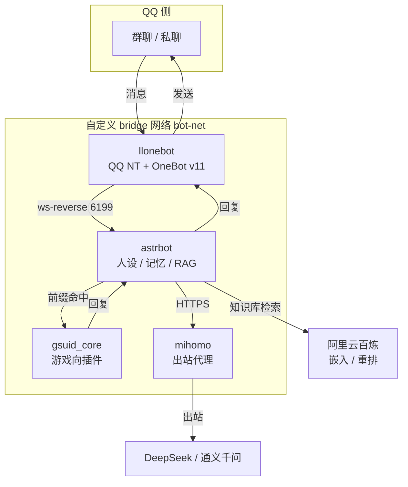
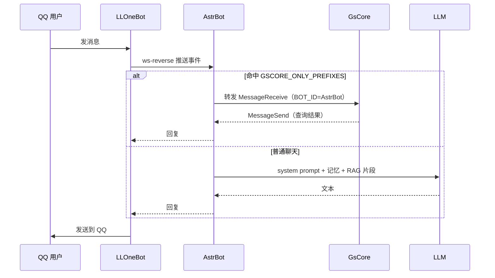

# 架构与设计

## 1. 全景



## 2. 端口与网络

| 容器 | 容器内端口 | 宿主机绑定 | 谁在访问 |
| --- | --- | --- | --- |
| llonebot | 3000 | `127.0.0.1:3000` | 可选的 HTTP 客户端 |
| llonebot | 3001 | `127.0.0.1:3001` | 正向 WebSocket 客户端 |
| llonebot | 3080 | `127.0.0.1:3080` | 你（浏览器，经 SSH 隧道） |
| llonebot | 5900 | `127.0.0.1:5900` | 你（VNC 客户端） |
| llonebot | 6099 | `127.0.0.1:6099` | 旧版 WebUI |
| astrbot | 6185 | `127.0.0.1:6185` | 你（浏览器，经 SSH 隧道） |
| astrbot | 6199 | `127.0.0.1:6199` | llonebot（也可以完全不开宿主映射，走 `astrbot:6199`） |
| gsuid_core | 8765 | `127.0.0.1:8765` | astrbot（走 `gsuid_core:8765`）、你（WebConsole） |
| mihomo | 7890 | 不映射 | astrbot（`mihomo:7890`） |

四个容器都在 `bot-net` 上，Docker 内置 DNS 会把容器名解析成当前 IP。所以服务之间**用名字**互相访问，不写死 IP。

## 3. 一次消息的时序



## 4. 为什么这样设计

### 4.1 为什么拆成四个容器

- QQ 登录（LLOneBot）和对话逻辑（AstrBot）生命周期不同：QQ 掉线要重扫码，但不需要动 AstrBot。
- GsCore 的插件依赖多、更新频繁，单独一个容器可以随时重建，不影响聊天。
- 代理（mihomo）只服务 AstrBot 的出站，独立出来最省心：换节点不用碰其他服务。

### 4.2 为什么端口只绑 127.0.0.1

`docker run -p 127.0.0.1:6185:6185` 里的 `127.0.0.1` 是**宿主机**的回环地址。Docker 只在这张「内网网卡」上监听，公网流量到不了。

需要管理时用 SSH 隧道：

```bash
# 把服务器的 6185 映射到你本机的 6185，浏览器就能访问 http://127.0.0.1:6185
ssh -L 6185:127.0.0.1:6185 root@<ECS_IP>
```

### 4.3 为什么用反向 WebSocket

正常方向是「AstrBot 去连 LLOneBot」。反向 WS 是反过来：**LLOneBot 主动连 AstrBot**。好处是 AstrBot 不需要知道 LLOneBot 的地址，容器重建也不影响，只要 LLOneBot 的 URL 写对。

这也是坑的来源：早期把 URL 写成容器 IP（`172.x.x.x` 这种），容器一重建 IP 就变，连接直接断。正确写法是同网络的服务名：`ws://astrbot:6199/ws`。

### 4.4 代理为什么只给 AstrBot

- GsCore 要访问国内游戏接口，走代理反而慢或失败。
- LLOneBot 连的是 QQ 服务器，不需要代理。
- 只有 AstrBot 要访问境外 LLM API。

`NO_PROXY` 里必须写上所有容器名和 `127.0.0.1`，否则容器之间互相访问也会被代理接管，表现为「明明在同一网络却连不上」。

### 4.5 bot-net 是 external 网络

四份 compose 各自独立，网络由 `docker network create bot-net` 提前建好，compose 只声明 `external: true`。这样任何一个服务 `down` 都不会把网络删掉，其他容器不受影响。

代价是：新机器上必须先建网络，否则 `docker compose up` 会报 `network bot-net not found`。

## 5. 配置分别在哪

| 配置 | 位置 | 是否进仓库 |
| --- | --- | --- |
| 四个服务的编排 | `deploy/*` | 是 |
| LLOneBot 的 OneBot 连接 | `deploy/llonebot/llonebot-data/data/config_<QQ号>.json` | 否（含 Token） |
| AstrBot 的模型 / 插件 / 知识库 | `deploy/astrbot/data/`（WebUI 写入） | 否（含 Key） |
| GsCore 的 Token / 主人 | `deploy/gscore/gsuid_core/data/config.json` | 否（只放示例） |
| 代理订阅 | `deploy/mihomo/config.yaml` | 否 |

## 6. 已知边界

- **内存**：4 GiB 机器跑四个容器，余量约 1 GiB。AstrBot 做 RAG 和长上下文时最吃内存。
- **容器 Up ≠ 服务可用**：LLOneBot 出现过「容器 Up、QQ 已掉线」的静默失败，`restart` 策略救不了，详见 [troubleshooting 第 9 节](troubleshooting.md#9-容器-up-但机器人不回静默失败)。
- **没有健康检查**：只能处理进程退出，处理不了「进程活着但连不上」。
- **没有日志轮转**：Docker 的 json-file 日志会一直长，40 GB 盘要留意。
- **端口暴露**：本仓库把 6199 收紧到 `127.0.0.1`；线上如果还是 `0.0.0.0`，建议同步。
- **单机**：没有反向代理、没有 HTTPS、没有多机。要加的话，Nginx + 证书是下一步。
